  <picture>
    <source media="(prefers-color-scheme: dark)" srcset="assets/banner-dark.svg">
    
  </picture>

  <a href="https://lening.li/">Website</a> ·
  <a href="https://scholar.google.com/citations?user=KWUJ10wAAAAJ">Google Scholar</a> ·
  <a href="https://www.linkedin.com/in/lening-li">LinkedIn</a> ·
  <a href="mailto:leningli@outlook.com">Email</a>

### Hi, I'm Lening 👋

I work on **robots that reason, learn, and act** — from motion planning and reinforcement learning to agentic AI for robotics.

- 🔬 Research Affiliate at **Yale University** and Robotic Lab Advisor at **Harvard University**.
- 🎓 Ph.D. in Robotics Engineering from **WPI**; pursuing an MBA at **CMU Tepper**.
- 🧭 Interested in **stochastic control, game theory, and formal methods**: turning high-level tasks into policies with guarantees.
- 🤖 Outside research, I coach student robotics. Team **10102Z** won the middle school world championship at VEX Worlds 2025.

### From ideas to systems

<table>
  <tr>
    <td width="50%" valign="top">
      <h3>🧠 Learning &amp; reasoning</h3>
      Reinforcement learning, temporal logic, and decision-making under uncertainty.
    </td>
    <td width="50%" valign="top">
      <h3>🦾 Robotics &amp; agents</h3>
      Motion planning, robot autonomy, and coding agents that work with physical systems.
    </td>
  </tr>
</table>

   &nbsp;
   &nbsp;
   &nbsp;
  

### A few things I've built

<table>
  <tr>
    <td width="50%" valign="top">
      <h3><a href="https://github.com/leelening/pddl_parser">🧩 PDDL Parser</a></h3>
      Parse planning problems and explore their reachable transition systems.
        <code>Python</code> <code>Planning</code>
    </td>
    <td width="50%" valign="top">
      <h3><a href="https://github.com/leelening/rrt">🌳 RRT Motion Planner</a></h3>
      Sampling-based motion planning in C++ with OpenRAVE.
        <code>C++</code> <code>Robotics</code>
    </td>
  </tr>
  <tr>
    <td width="50%" valign="top">
      <h3><a href="https://github.com/leelening/books">📚 The Reading Shelf</a></h3>
      A curated collection of classic computer science and robotics books.
        <code>Computer science</code> <code>Robotics</code>
    </td>
    <td width="50%" valign="top">
      <h3><a href="https://lening.li/">🔬 Research &amp; Publications</a></h3>
      My research, publications, and notes from a life in robotics.
        <code>Research</code> <code>Open science</code>
    </td>
  </tr>
</table>

### On GitHub

  <a href="https://github.com/leelening?tab=repositories">
    <picture>
      <source media="(prefers-color-scheme: dark)" srcset="https://github-readme-stats.vercel.app/api?username=leelening&amp;disable_animations=true&amp;hide_rank=true&amp;show_icons=true&amp;hide_border=true&amp;bg_color=00000000&amp;title_color=5eead4&amp;icon_color=5eead4&amp;text_color=cbd5e1">
      
    </picture>
  </a>

  Let's talk robots, learning, and what comes next. <a href="mailto:leningli@outlook.com">Say hello ↗</a>

